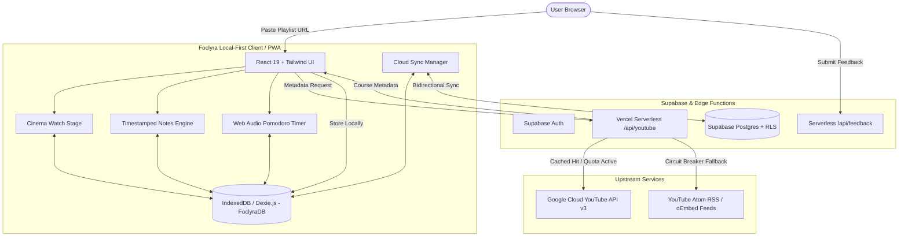

# Foclyra

> **The Distraction-Free, Local-First Study Studio for YouTube Developer Courses & Playlists.**

[](https://react.dev/)
[](https://vitejs.dev/)
[](https://tailwindcss.com/)
[](https://dexie.org/)
[](https://supabase.com/)
[](LICENSE)

**Live Demo**: [https://foclyra.vercel.app/](https://foclyra.vercel.app/)  
**Source Code**: [https://github.com/ssiddiquiii/foclyra](https://github.com/ssiddiquiii/foclyra)

---

## Overview

YouTube is home to the world's highest-quality software engineering tutorials, but it is architected for algorithmic engagement: autoplay feeds, recommendation rabbit holes, sensational thumbnails, and distracting comment threads derail deep focus.

**Foclyra** transforms any public YouTube playlist or single-video crash course into a professional, distraction-free study environment: zero ads, zero algorithmic feeds, rich timestamped notes, dynamic Pomodoro focus intervals, and instant local-first persistence.

---

## Key Features

### 🎬 Udemy-Style Cinema Watch Stage
- **Edge-to-Edge Theater Mode**: Ultra-clean black stage with strict vertical viewport fitting (`calc(100vh - 170px)`) that ensures the video player and syllabus fit neatly on your screen without awkward page overflows.
- **Collapsible Syllabus Drawer**: Hide the playlist for pure full-screen immersion; reopen it anytime with the floating `[< Lectures]` indicator or keyboard shortcut (`S`).
- **Floating Lecture Controls**: Jump seamlessly to the previous or next lecture with floating quick-nav buttons and keyboard shortcuts (`P` / `N`).
- **Resilient Playback Persistence**: Remembers your exact second, speed, and caption preferences across sessions.

### 📝 Timestamped Notes Engine
- **Live Video Sync**: Capture Markdown notes while watching; clicking any timestamp instantly seeks the video to that exact concept.
- **Debounced Auto-Save**: Real-time persistence into local IndexedDB without frame drops.
- **One-Click Export**: Export notes to structured Markdown (`.md`) or full JSON course backups at any time.

### ⏱️ Persistent Pomodoro Focus System
- **Always With You**: Floating timer widget that remains synchronized across all route navigations.
- **Browser Tab Countdown**: Live countdown indicator directly in your browser tab title (e.g., `(24:50) 🎯 Focus | Foclyra`).
- **Synthesized Web Audio**: Soothing, built-in chime alerts when transitions occur without external audio asset dependencies.

### ⚡ Local-First Speed + Optional Cloud Sync
- **100% Client Ownership**: Works entirely offline with zero server database requirements via IndexedDB (Dexie.js).
- **Supabase Cloud Sync**: Log in to sync playlists, progress, and study notes across multiple devices with row-level security (RLS).
- **Multi-Tier Quotas**: Seamless guest usage (up to 5 saved courses) and generous registered tiers (up to 15 active courses).

### 🎨 State-of-the-Art Aesthetic
- **Neon Mint & Charcoal Palette**: Signature `#00F5D4` accent theme with deep charcoal surfaces (`#111216`), clean contrast ratios, and modern glassmorphism.
- **Vector Rounded Play Iconography**: Tailored SVG branding and favicons with geometric balance.
- **Unified Controls**: Symmetrical floating feedback reporting, clean navigation dock, and responsive mobile drawers.

---

## System Architecture



---

## Architectural Principles

1. **Local-First Client Storage**: All user data (progress, notes, courses, streaks) resides locally in IndexedDB (`FoclyraDB`). The app boots instantly and functions completely offline.
2. **Serverless Edge Defense**: YouTube API requests route through a protected Vercel serverless proxy with IP rate-limiting (15 req/min) and edge caching (24h TTL) to prevent API key exposure and eliminate quota exhaustion.
3. **Resilient Circuit Breaker**: If upstream API quotas deplete, the engine automatically falls back to YouTube's public Atom RSS and oEmbed feeds, guaranteeing zero import interruptions.
4. **Data Portability**: Full JSON backup import/export complies with open data standards—your notes and progress are never locked in.

---

## Tech Stack

| Layer | Technologies |
|---|---|
| **Frontend Framework** | React 19, React Router v7 |
| **Build & Tooling** | Vite 8, Oxlint |
| **Styling & Icons** | Tailwind CSS v4, Lucide React |
| **Local Database** | Dexie.js (IndexedDB wrapper) |
| **Cloud & Auth** | Supabase JS (Auth, PostgreSQL, Row-Level Security) |
| **State Management** | Zustand (Global UI, Watch Player Controller) |
| **Data Validation** | Zod (Backup schemas & runtime data validation) |
| **Offline & PWA** | Vite PWA Plugin, Service Worker (Workbox) |
| **Edge Serverless** | Vercel Serverless Functions (`/api/youtube`, `/api/feedback`) |

---

## Getting Started

### Prerequisites
- **Node.js**: v18+ (Node.js 20 recommended)
- **npm** or **pnpm**

### Installation

```bash
# 1. Clone the repository
git clone https://github.com/ssiddiquiii/foclyra.git
cd foclyra

# 2. Install dependencies
npm install

# 3. Configure environment variables (optional)
cp .env.example .env

# 4. Start local development server
npm run dev
```

Visit [http://localhost:5173](http://localhost:5173) in your browser.

---

## Verification & Testing

Foclyra features a multi-phase verification suite ensuring data safety, scoped reads, UI responsiveness, and player persistence:

```bash
# Run unit & headless verification suites
npm test

# Run individual verification phases
npm run test:unit
npm run test:security
npm run test:phase4
npm run test:phase5
npm run test:phase6a
npm run test:phase6c
```

---

## Keyboard Shortcuts

| Shortcut | Action |
|---|---|
| `Space` / `K` | Play / Pause video |
| `J` / `L` | Seek -10s / +10s |
| `M` | Mute / Unmute audio |
| `F` | Toggle Fullscreen |
| `N` | Next lecture in playlist |
| `P` | Previous lecture in playlist |
| `S` | Toggle Syllabus playlist drawer |
| `Ctrl + K` / `Cmd + K` | Open Command Palette |
| `Esc` | Close drawers, modals, or fullscreen |

---

## License

This project is licensed under the [MIT License](LICENSE).
