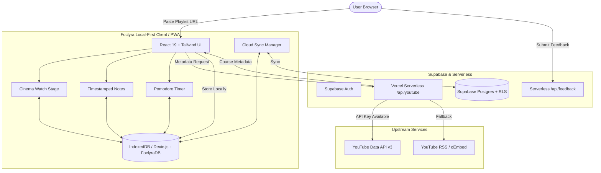

# Foclyra

> **The Distraction-Free, Local-First Study Studio for YouTube Developer Courses & Playlists.**

---

## Overview

YouTube is home to the world's highest-quality software engineering tutorials, but it is architected for algorithmic engagement: autoplay feeds, recommendation rabbit holes, sensational thumbnails, and distracting comment threads derail deep focus.

**Foclyra** transforms any public YouTube playlist or single-video crash course into a distraction-free study environment: no ads, no algorithmic feeds, timestamped notes, Pomodoro focus intervals, and instant local-first persistence.

---

## Key Features

### Cinema Watch Stage
- **Default & Theater Views**: A rounded 16:9 player card next to the playlist, or a full-width black theater mode with side gaps for immersive viewing.
- **Collapsible Syllabus**: Hide the playlist for full focus and reopen it anytime from the lectures tab or the "Show Playlist" button.
- **Compact Player Controls**: Slim progress bar, small buttons, and a settings menu for speed, quality, and captions. Controls auto-hide while playing.
- **Resilient Playback Persistence**: Remembers your exact second, speed, and caption preferences across sessions.

### Timestamped Notes
- **Live Video Sync**: Take notes while watching; clicking a timestamp seeks the video to that moment.
- **Auto-Save**: Notes are saved locally in IndexedDB as you type.
- **Export**: Export notes as Markdown (`.md`) or full course backups as JSON.

### Pomodoro Focus Timer
- **Always With You**: Floating timer that stays active across page navigation.
- **Tab Countdown**: Live countdown in the browser tab title.
- **Built-in Chime**: Alert sound generated with Web Audio, no external audio files.

### Local-First + Optional Cloud Sync
- **Your Data Stays Local**: Everything is stored in your browser with IndexedDB (Dexie.js) and works offline.
- **Supabase Cloud Sync**: Sign in to sync playlists, progress, and notes across devices, protected by row-level security.
- **Course Limits**: Guests can save 1 playlist; registered users can save up to 5.

### Modern Course Pages
- **Course Detail**: Hero card with 16:9 thumbnail, progress tracking, lecture search, and a clean syllabus list.
- **Theme**: Neon mint accent on charcoal surfaces with light and dark modes.

---

## System Architecture



---

## Architectural Principles

1. **Local-First Storage**: Progress, notes, courses, and streaks live in IndexedDB (`FoclyraDB`). The app boots instantly and works offline.
2. **Serverless Proxy**: YouTube API requests go through a Vercel serverless function so the API key is never exposed to the browser.
3. **Fallback Import**: If the API is unavailable or out of quota, import falls back to YouTube's public RSS and oEmbed feeds.
4. **Data Portability**: Full JSON backup import/export, so your notes and progress are never locked in.

---

## Tech Stack

| Layer | Technologies |
|---|---|
| **Frontend** | React 19, React Router v7 |
| **Build & Tooling** | Vite 8, Oxlint |
| **Styling & Icons** | Tailwind CSS v4, Lucide React |
| **Local Database** | Dexie.js (IndexedDB) |
| **Cloud & Auth** | Supabase (Auth, PostgreSQL, RLS) |
| **State Management** | Zustand |
| **Validation** | Zod |
| **PWA** | Vite PWA Plugin, Workbox |
| **Serverless** | Vercel Functions (`/api/youtube`, `/api/feedback`) |

---

## Getting Started

### Prerequisites
- **Node.js** v18+ (v20 recommended)
- **npm**

### Installation

```bash
# 1. Clone the repository
git clone <your-repo-url>
cd foclyra

# 2. Install dependencies
npm install

# 3. Configure environment variables (optional)
cp .env.example .env

# 4. Start the dev server
npm run dev
```

Open `http://localhost:5173` in your browser.

---

## Verification & Testing

```bash
# Run all verification suites
npm test

# Run individual suites
npm run test:unit
npm run test:security
npm run test:phase4
npm run test:phase5
npm run test:phase6a
npm run test:phase6c
```

---

## Keyboard Shortcuts

| Shortcut | Action |
|---|---|
| `Space` / `K` | Play / Pause |
| `J` / `ArrowLeft` | Seek back 5s |
| `L` / `ArrowRight` | Seek forward 5s |
| `M` | Mute / Unmute |
| `F` | Fullscreen |
| `C` | Toggle captions |
| `Ctrl + K` / `Cmd + K` | Open Command Palette |
| `Alt + D` | Go to Dashboard |
| `Alt + S` | Go to Settings |
